# 跨模态检索中心 · 系统数据流
| 项 | 内容 |
| --- | --- |
| 日期 | 2026-10-29 |
| 依据 | 交付原型 `原型v5/index.html`（9 页） |
| 读者 | 产品、研发、测试 |
| 写法 | 每个流程四块：目标、图、说明、状态。说明用 1、2、3，一步一行 |

字段以技术方案为准。页面上的进度条是演示，正式实现按段调用。

图例：深蓝底是一级模块。粗蓝框是二级模块，框内模块名加粗。灰细框是功能点。虚线框是外部系统。浅灰细边是步骤，不是模块。

## 1. 业务总流
**目标：** 上游数据集变成可检索库，用户搜到结果集。反馈和评测回流，改数据或改策略。建库只做到可检索，策略和评测不在建库里做完。

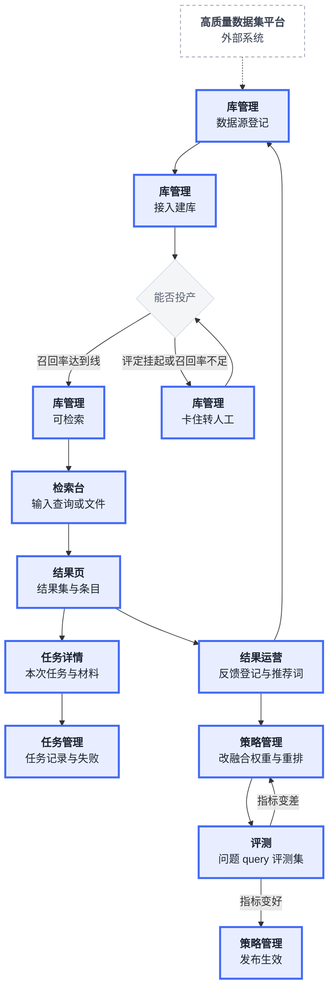

**说明：**

1. 数据集平台交来元数据与文件，库管理登记数据源后自动跑到可检索。
2. 卡住才转人工：评定挂起裁决、投产召回率不足确认、治理异常处理。
3. 检索台发起查询，结果页出结果集，任务详情看本次任务，任务管理看全部任务。
4. 反馈只做登记与处理，改数据回库管理，改策略进策略管理。
5. 评测拿问题 query 跑评测集，指标变好才发布策略。

各步状态见第 3 节。

## 2. 技术流
**目标：** 四模态落在同一向量空间，召回、融合、重排三步出结果集。向量模型固定不可切换，换模型等于换一套空间，跨模态对齐会断。

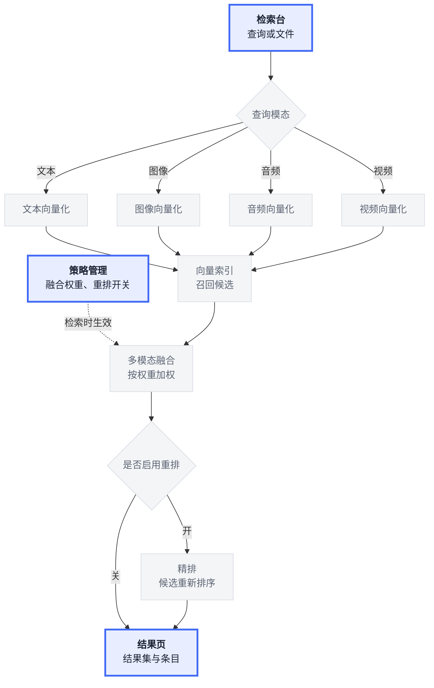

**说明：**

1. 查询按模态走各自的向量化，查询向量与库内向量落在同一空间。
2. 向量索引按相似度召回候选，召回不是最终排序。
3. 融合按策略里的四模态权重加权，权重合计固定 100%。
4. 重排开启时对候选再排一次，关闭时按召回顺序返回。
5. 向量模型由平台固定，策略里只读回显。

## 3. 分流程
### 3.1 建库
**目标：** 上游一个数据集变成可检索库。登记数据源后自动跑完整条链，卡住才转人工。可检索之后还有增量，不算在建库结束里。

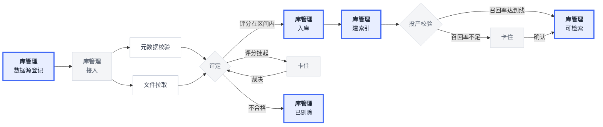

**说明：**

1. 登记数据源要填名称、接口地址、协议、认证，地址必须以 http 或 https 开头。
2. 接入自动做元数据校验与文件拉取，校验的是模态构成、条数、场景。
3. 评定给分，评分在区间内入库，挂起转人工裁决，不合格剔除。
4. 入库后建索引，投产前校验召回率，低于线转人工确认。
5. 卡住的三种情况：评定挂起、投产召回率不足、治理异常。

**状态：**

| 当前 | 触发 | 前置 | 下一 |
| --- | --- | --- | --- |
| 无 | 登记数据源 | 名称、接口地址、协议、认证齐全 | 接入中 |
| 接入中 | 接入完成 | 系统自动 | 评定中 |
| 评定中 | 评定通过 | 评分在区间内 | 已入库 |
| 评定中 | 评定挂起 | 评分为挂起区间 | 卡住 |
| 卡住 | 裁决通过 | 人工裁决 | 已入库 |
| 卡住 | 裁决不通过 | 人工裁决 | 已剔除 |
| 已入库 | 开始建索引 | 系统自动 | 建索引中 |
| 建索引中 | 索引完成 | 系统自动 | 可检索 |
| 卡住 | 确认投产 | 召回率达到线 | 可检索 |
| 已剔除 | 无 | 无 | 状态不变 |

不允许：评定中直接跳可检索；已剔除回到接入中。

### 3.2 检索
**目标：** 一次查询变成一个结果集。结果集生成即本步结束，采用或废弃不在检索里做完。

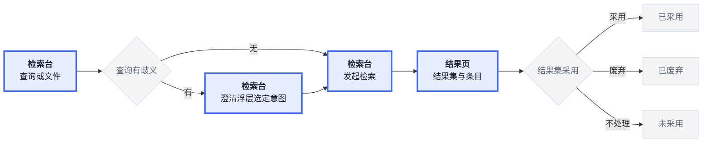

**说明：**

1. 输入可以是文本、图片、音频、视频，也可以同时给查询模态和目标模态。
2. 查询有歧义时先澄清一轮，选意图后继续检索，最多一轮。
3. 检索直出结果页，不设中间确认页。
4. 结果页显示结果集编号、条数、条目列表，按相似度降序。
5. 结果集可标采用或废弃，不标保持未采用。

**状态：**

| 当前 | 触发 | 前置 | 下一 |
| --- | --- | --- | --- |
| 无 | 发起检索 | 有查询或文件 | 未采用 |
| 未采用 | 采用 | 无 | 已采用 |
| 未采用 | 废弃 | 无 | 已废弃 |
| 已采用 | 无 | 无 | 状态不变 |
| 已废弃 | 无 | 无 | 状态不变 |

不允许：已采用改已废弃；已废弃改已采用。

### 3.3 任务
**目标：** 每次检索留下一条任务记录。任务跑完或失败即本步结束，失败处置由系统自动做，页面只展示结果。

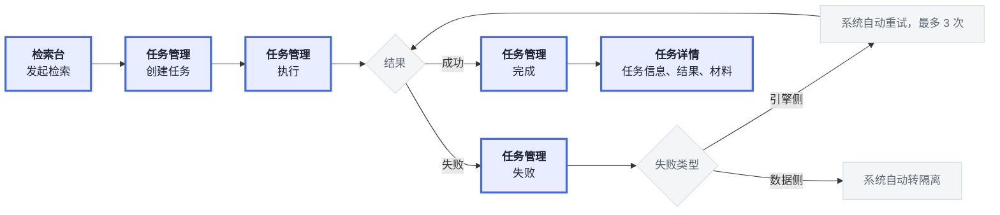

**说明：**

1. 检索台发起检索时创建任务，任务号按 TASK 规范生成。
2. 执行成功转完成，失败转失败并记录失败类型。
3. 引擎侧失败由系统自动重试，最多 3 次；数据侧失败自动转隔离。
4. 失败任务只读展示失败原因、失败类型、系统处理结果，不设人工派单。
5. 任务详情只放任务信息、结果、材料三块，材料只读。

**状态：** 任务列表上是两列：任务状态、失败处置。没失败时失败处置显示「—」。

| 任务状态 | 失败处置 | 触发 | 前置 | 任务状态变为 | 失败处置变为 |
| --- | --- | --- | --- | --- | --- |
| 无 | — | 创建任务 | 有查询或文件 | 就绪 | — |
| 就绪 | — | 开始执行 | 系统自动 | 执行中 | — |
| 执行中 | — | 执行成功 | 系统自动 | 完成 | — |
| 执行中 | — | 执行失败（引擎侧） | 系统自动 | 失败 | 重试中 |
| 执行中 | — | 执行失败（数据侧） | 系统自动 | 失败 | 已转隔离 |
| 失败 | 重试中 | 重试成功 | 未满 3 次 | 完成 | 已恢复 |
| 失败 | 重试中 | 重试满 3 次 | 已重试 3 次 | 失败 | 已转隔离 |

不允许：完成回到执行中；已恢复改回重试中；已转隔离改回重试中；失败页人工改状态。

### 3.4 策略
**目标：** 一条策略改完参数，经草稿、评审、发布三步生效。发布生效即本步结束，回滚另起一步。

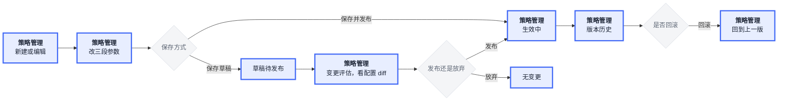

**说明：**

1. 策略只有三段参数：向量（只读）、融合权重、重排开关。
2. 存草稿只写库不生效；直接发布则对该场景下一次检索立即生效。
3. 草稿可在变更评估里对比上一版，就地发布或放弃。
4. 发布后写版本历史，版本号递增。
5. 回滚把配置、状态、版本号一起回写，出核验回执。

**状态：**

| 当前 | 触发 | 前置 | 下一 |
| --- | --- | --- | --- |
| 无 | 新建策略 | 有名称、有适用场景 | 草稿 |
| 草稿 | 保存草稿 | 名称非空 | 编辑中 |
| 草稿 | 保存并发布 | 名称非空 | 生效中 |
| 编辑中 | 保存并发布 | 名称非空 | 生效中 |
| 编辑中 | 放弃草稿 | 无 | 生效中 |
| 生效中 | 保存草稿 | 名称非空 | 编辑中 |
| 生效中 | 发布草稿 | 有草稿待发布 | 生效中 |
| 生效中 | 回滚 | 有历史版本 | 生效中 |

发布和回滚不改状态名，只改版本号：发布递增一版，回滚退到所选版本。

不允许：草稿直接改已生效版本的配置；同一场景同时存在两条生效策略。

### 3.5 评测
**目标：** 一批问题 query 变成一组指标和一条结论。结论出来后转策略调整即本步结束，改策略不在评测里做。

```mermaid
flowchart LR
  H["<b>结果运营</b><br/>检索历史"] --> A["<b>评测</b><br/>新建评测集"]
  A --> B["筛问题 query\n零结果、无点击、复搜"]
  B --> C["<b>评测</b><br/>人工标注标准答案"]
  C --> D{标注完成}
  D -->|未完成| C
  D -->|完成| E["<b>评测</b><br/>评测集已完成"]
  E --> F["<b>评测</b><br/>选评测对象（策略）"]
  F --> G["<b>评测</b><br/>跑评测集出指标"]
  G --> M["指标\n召回率、精确率、排序质量"]
  M --> N["<b>评测</b><br/>对比上次，出结论"]
  N --> O{结论}
  O -->|未达标| P["转策略调整"]
  O -->|达标| Q["保留"]

  classDef l2 fill:#e8eeff,stroke:#4169f6,color:#1c2434,stroke-width:3px
  classDef fn fill:#ffffff,stroke:#b7c0d0,color:#3a4252,stroke-width:1px
  classDef step fill:#f4f5f7,stroke:#d5dae3,color:#5c6573,stroke-width:1px
  class H,A,C,E,F,G,N,P,Q l2
  class B,M fn
  class D,O step
```

**说明：**

1. 评测集从检索历史筛问题 query，筛的是零结果、无点击、复搜三类。
2. 筛出来是标注中，人工逐条标标准答案，标完转已完成。
3. 评测对象是策略，可选当前生效、候选草稿、系统默认兜底。
4. 跑完出口径：召回率、精确率、排序质量，各自带验收线。
5. 结论对比上次评测，未达标转策略调整，达标保留。

**状态：**

| 当前 | 触发 | 前置 | 下一 |
| --- | --- | --- | --- |
| 无 | 新建评测集 | 名称非空，至少勾一个筛选条件 | 标注中 |
| 标注中 | 完成标注 | 每条已标对或错 | 已完成 |
| 已完成 | 开始评测 | 选评测对象 | 状态不变 |
| 已完成 | 转策略调整 | 有未达标指标 | 状态不变 |

评测不改评测集状态。每次开始评测新增一条评测历史；转策略调整只是跳页。

不允许：标注中的评测集进入评测工作台。

### 3.6 结果运营
**目标：** 用出来的问题变成可处理的反馈单，运营维护的推荐词推到检索台联想。反馈闭环或推荐词状态变完即本步结束。

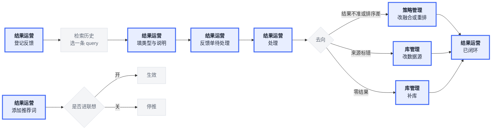

**说明：**

1. 登记反馈先从检索历史分页选一条 query，再填反馈类型与说明。
2. 反馈类型只有四种：结果不准、排序差、来源标错、零结果。
3. 类型决定去向：结果不准和排序差改策略，来源标错改数据，零结果补库。
4. 处理完转已闭环，闭环后不再改。
5. 推荐词由运营维护，开关即时生效，开进检索台联想、关不进入。

**状态：**

| 当前 | 触发 | 前置 | 下一 |
| --- | --- | --- | --- |
| 无 | 登记反馈 | 选中一条 query，填类型 | 待处理 |
| 待处理 | 开始处理 | 无 | 处理中 |
| 处理中 | 处理完成 | 已按去向改完 | 已闭环 |
| 待处理 | 处理完成 | 已按去向改完 | 已闭环 |
| 已闭环 | 无 | 无 | 状态不变 |

不允许：已闭环改回处理中。

## 4. 模块之间的数据
**目标：** 看数据往哪交。线只向右，不画返回线。写回单独放在第二张图。

**交给下一站：**

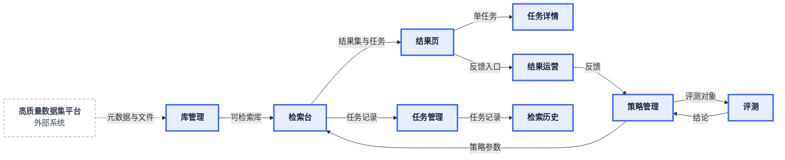

**写回：**

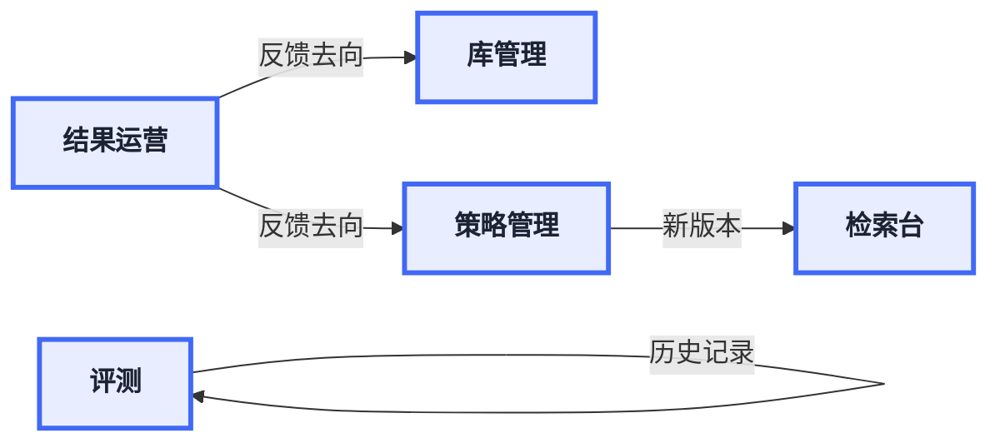

**说明：**

1. 第一张从左到右：外部数据集到库管理，库管理到检索台，检索台分到结果页、任务管理、检索历史。
2. 结果页把反馈入口交给结果运营，结果运营再分到策略管理和库管理。
3. 策略管理把策略参数交给检索台，把评测对象交给评测。
4. 第二张只看写回：反馈写回库管理或策略管理，策略发布后检索台按新版本生效。

## 5. 模块功能架构
**目标：** 分清一级、二级和功能点。深蓝是一级，粗蓝框是二级，灰细框是功能点。

```mermaid
flowchart TB
  SYS["跨模态检索中心"] --> DATA["<b>数据</b>"]
  SYS --> SEARCH["<b>检索</b>"]
  SYS --> GOV["<b>策略与运营</b>"]

  DATA --> KM["<b>库管理</b>"]
  KM --> K1["数据集列表"]
  KM --> K2["数据源登记"]
  KM --> K3["裁决"]
  KM --> K4["确认投产"]
  KM --> K5["异常处理"]

  SEARCH --> ST["<b>检索台</b>"]
  SEARCH --> RP["<b>结果页</b>"]
  SEARCH --> TD["<b>任务详情</b>"]
  SEARCH --> TM["<b>任务管理</b>"]
  SEARCH --> TH["<b>检索历史</b>"]

  ST --> S1["查询输入"]
  ST --> S2["模态矩阵"]
  ST --> S3["业务场景"]
  ST --> S4["澄清浮层"]

  RP --> R1["结果集概要与采用"]
  RP --> R2["结果筛选"]
  RP --> R3["结果条目"]
  RP --> R4["空结果处置"]
  RP --> R5["反馈入口"]

  TD --> D1["任务信息"]
  TD --> D2["结果"]
  TD --> D3["材料"]

  TM --> T1["任务列表"]
  TM --> T2["失败任务"]

  TH --> E1["查询历史"]
  TH --> E2["查看结果与再次执行"]

  GOV --> SM["<b>策略管理</b>"]
  GOV --> EV["<b>评测</b>"]
  GOV --> OP["<b>结果运营</b>"]

  SM --> M1["策略列表与编辑"]
  SM --> M2["保存草稿与发布"]
  SM --> M3["变更评估"]
  SM --> M4["版本回滚"]
  SM --> M5["业务场景字典"]

  EV --> V1["评测集"]
  EV --> V2["标注"]
  EV --> V3["评测工作台"]
  EV --> V4["报告与评测历史"]

  OP --> O1["登记反馈"]
  OP --> O2["反馈处理"]
  OP --> O3["运营推荐词"]

  classDef l1 fill:#4169f6,stroke:#4169f6,color:#ffffff,stroke-width:2px
  classDef l2 fill:#e8eeff,stroke:#4169f6,color:#1c2434,stroke-width:3px
  classDef fn fill:#ffffff,stroke:#b7c0d0,color:#3a4252,stroke-width:1px
  classDef root fill:#ffffff,stroke:#1c2434,color:#1c2434,stroke-width:1px
  class DATA,SEARCH,GOV l1
  class KM,ST,RP,TD,TM,TH,SM,EV,OP l2
  class K1,K2,K3,K4,K5,S1,S2,S3,S4,R1,R2,R3,R4,R5,D1,D2,D3,T1,T2,E1,E2,M1,M2,M3,M4,M5,V1,V2,V3,V4,O1,O2,O3 fn
  class SYS root
```

**说明：**

1. 一级三个：数据、检索、策略与运营。没有独立页面。
2. 二级九个：库管理、检索台、结果页、任务详情、任务管理、检索历史、策略管理、评测、结果运营。
3. 灰框是这九个页面上的功能点。
