# 跨模态检索中心 · 系统数据流
| 项 | 内容 |
| --- | --- |
| 日期 | 2026-11-09 |
| 依据 | 原型v5 的 P1–P8 八个页面 |
| 读者 | 产品、研发、测试 |
| 写法 | 每个流程四块：目标、图、说明、状态；纯边界说明只给目标、说明与状态。说明用 1、2、3，一步一行 |

图例：粗蓝框是二级模块，框内模块名加粗。灰细框是功能点。虚线框是外部系统。浅灰细边是步骤，不是模块。深蓝底是一级模块，只出现在第 5 节。页面上的进度与条数为演示，正式实现按段调用。

## 1. 业务总流
**目标：** 上游数据源在数据源库管理里完成对接、字段检测与向量化，成为可供检索的数据源；用户在检索台选检索策略、发起查询，一次查询换一屏结果卡。每次检索生成一个任务号，任务号贯穿结果页、搜索行为、搜索结果摘要与效果评测。结果的使用痕迹沉到搜索行为，评价与零结果沉到结果运营；策略改版与评测验证各自成节。

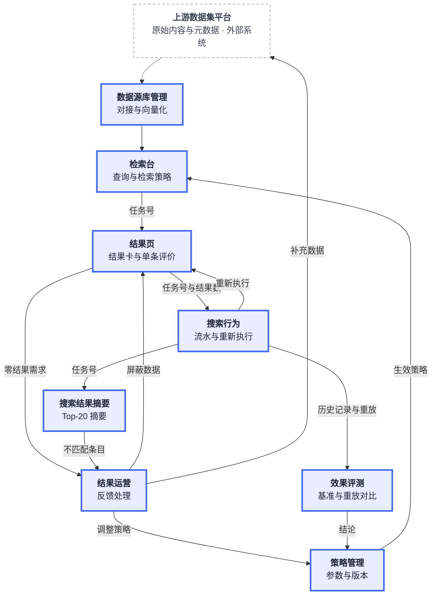

**说明：**

1. 上游数据集平台只交原始内容与元数据，数据源库管理负责对接、测试连接与向量化；已连接的数据源进入检索范围。
2. 检索台选一条生效策略，发起查询；每次检索生成一个任务号，并随参数带到结果页。
3. 结果页出结果卡，同时写任务元数据与 Top-20 摘要：任务元数据供搜索行为合并流水，摘要供搜索结果摘要按任务号回读。
4. 搜索结果摘要用任务号取摘要，Top-20 摘要表供核对与勾选不匹配条目。
5. 结果页的赞踩与零结果需求、搜索结果摘要的不匹配条目，都进结果运营，按三种去向处理。
6. 搜索行为留详情与重新执行；重新执行按当时条件重跑并生成新记录、新任务号。
7. 策略管理给检索台生效策略与参数；效果评测拿一条历史任务当基准，比后续每次重放，结论回策略管理。

## 2. 技术流（四模态统一向量空间 + 召回 + 融合 + 重排）
**目标：** 四种模态的查询与库内条目落在同一个向量空间；库内向量由平台在接入时统一抽取。一次检索走召回、融合、重排三步出结果卡。阈值、融合权重与重排开关取本次检索所选策略的生效版本。结果卡出屏即本步结束，评价与摘要落库见第 3 节。

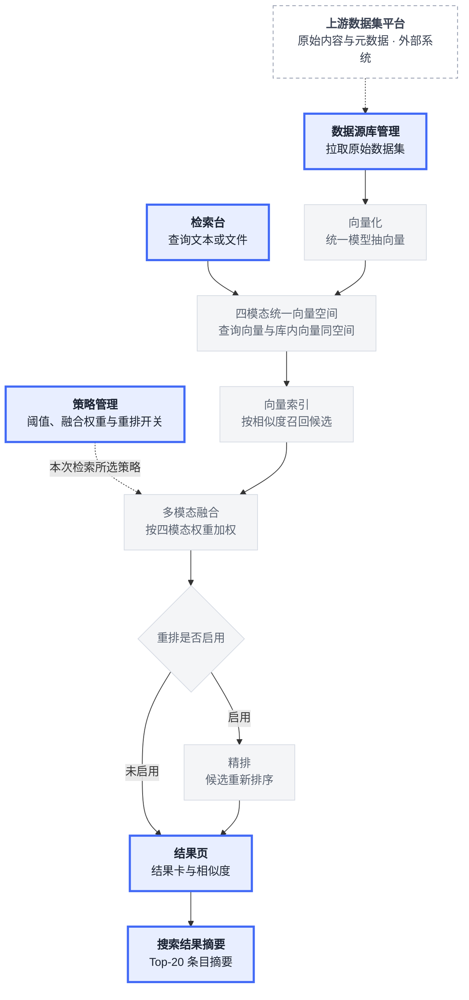

**说明：**

1. 上游只提供原始内容与元数据，不提供向量；数据源库管理拉取后用平台统一模型逐条抽向量。
2. 向量化按条目声明的 1~4 个模态分别抽取；同一条目下的多个模态落在同一条目下，即对齐关系。
3. 查询按模态向量化，文本、图像、音频、视频共用一套空间，查询向量与库内向量可直接比。
4. 向量模型由平台固定，策略里只读回显；换模型等于换一套空间，跨模态对齐就断。
5. 向量索引按相似度召回候选，候选集供融合用，召回排名不是最终次序。
6. 融合按策略里的四模态权重加权；相似度阈值决定哪些条目返回，权重与阈值取本次检索所选策略的生效版本。
7. 重排开关打开时精排模型对候选再排一次，关闭时按融合分返回；结果卡带相似度、来源与对齐分，靠前的条目写成 Top-20 摘要随任务落库。

## 3. 分流程
### 3.1 建库（P4）
**目标：** 上游一个数据源在数据源库管理里完成对接，测试连接逐字段检测通过后转为已连接，平台拉取原始内容并统一向量化，数据进入检索范围。本步只做数据源与黑名单两块，不按数据集逐条评审，也不设人工卡点。

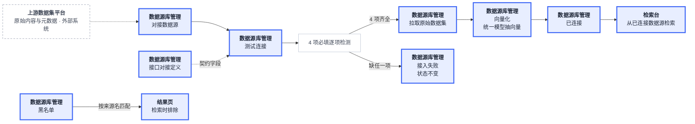

**说明：**

1. 数据源库管理只有两块：数据源列表与黑名单抽屉。数据源列表列为名称、地址、状态（已连接 / 未连接 / 连接失败）、字段完备（4/4）、向量化、上次同步、操作。
2. 对接数据源只填名称与地址，地址以 http:// 或 https:// 开头且不能有空格；保存后状态为未连接。
3. 测试连接逐字段检测 4 项必填：dataset_id、name、item_count、modals。4 项齐全转已连接；缺任一项判接入失败，状态保持原样。
4. 接口对接定义是只读契约：上游只提供原始内容与元数据，不提供向量，向量由平台抽取。
5. 数据集级必填 dataset_id、name、item_count，可选 modal_types；条目级必填 item_id、modals，modals 为 1~4 个模态，由每条自己声明。
6. 同一条目下的多个模态就是对齐关系，没有单独的 align_pairs 字段；缺 modals 时无法确定模态，不可接入。
7. 已连接后平台自动拉取原始数据集并逐条向量化；列表显示向量化完成数 / 总数（如 27,930 / 27,930），未连接显示「—」，已连接可手动同步并刷新上次同步时间。
8. 黑名单填数据集 ID、名称、来源名、地址；结果页按来源名匹配结果条目的来源并排除，可随时移出，移出后按最新黑名单重算。

**状态：**

| 当前 | 触发 | 前置 | 下一 |
| --- | --- | --- | --- |
| 无 | 对接数据源 | 名称与地址齐全，地址以 http:// 或 https:// 开头且无空格 | 未连接 |
| 未连接 | 连接异常 | 地址不可达或接口报错 | 连接失败 |
| 未连接 | 测试连接通过 | 4 项必填齐全 | 已连接 |
| 连接失败 | 测试连接通过 | 4 项必填齐全 | 已连接 |
| 未连接 | 测试连接未通过 | 缺任一项必填 | 未连接（状态不变） |
| 连接失败 | 测试连接未通过 | 缺任一项必填 | 连接失败（状态不变） |
| 已连接 | 测试连接未通过 | 缺任一项必填 | 已连接（状态不变） |
| 已连接 | 同步完成 | 手动同步或系统自动同步 | 已连接（刷新上次同步） |

不允许：未通过测试连接的数据源进入检索范围；字段不全仍转已连接；黑名单里的来源仍被检索返回。

### 3.2 检索（P1 → P2，含赞踩与封存）
**目标：** 一次查询变成一屏结果卡，外加一份可封存的单条评价。每次检索先选策略，再生成任务号；结果数与评价写进该任务的记录。关掉页面即封存，本步结束；再评价或再搜都另起一个任务。

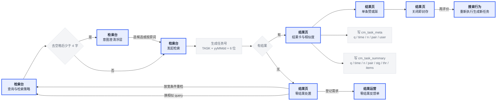

**说明：**

1. 检索台收文本或文件，选查询模态与目标模态组成模态对，四种模态两两组合共 16 种；再选检索策略，选项为系统默认、训练取样、业务素材、日常检索，下拉只列生效中的策略。
2. 策略下拉右侧显示本次参数摘要，如「阈值 0.60 · 重排开」；业务策略全部下线时回退系统默认策略并提示，检索仍可发起。
3. query 去空格后少于 4 字时弹意图澄清浮层；候选按输入派生，如「含 {q} 的扫描件」「{q} 高清扫描」「{q} 内容示意」，每个 query 最多澄清 1 轮。
4. 选候选时按候选文本检索，仍按原词时按原 query 检索，关闭浮层则不检索；纯文件检索不触发澄清。
5. 点击检索先校验，通过后生成任务号：TASK + yyMMdd + 6 位大写字母数字，去掉 I、O、0、1；同一 query 再检也是新任务号。
6. 任务号随地址栏的 task 参数带到结果页；结果页写两份数据：cm_task_meta（q / time / n / pair / user）与 cm_task_summary（q / time / n / pair / stg / thr / items，items 为 Top-20 条目数组）。
7. 结果卡给相似度、来源与对齐分，按相似度降序；侧栏按模态分组、相似度阈值、来源收窄，阈值初值取所选策略。
8. 零结果给三条处置：放宽条件回检索台重检、换相似 query 回检索台重检、登记需求进结果运营。
9. 单条赞或踩二选一，同向再点取消、反向改向；评价按任务号与条目号落一份，汇总成该任务的赞踩数。
10. 关掉本次运行即封存：本次赞踩定版，再评价走重新执行，拿新任务号重新评。

**状态：**

| 当前 | 触发 | 前置 | 下一 |
| --- | --- | --- | --- |
| 未评价 | 点赞 | 本次运行未封存 | 赞 |
| 未评价 | 点踩 | 本次运行未封存 | 踩 |
| 赞 | 再点赞 | 本次运行未封存 | 未评价 |
| 赞 | 点踩 | 本次运行未封存 | 踩 |
| 踩 | 再点踩 | 本次运行未封存 | 未评价 |
| 踩 | 点赞 | 本次运行未封存 | 赞 |

不允许：封存后改评价方向；封存后再点回未评价；一条评价同时记赞和踩。

### 3.3 搜索行为（P6，流水 + 重新执行，无状态）
**目标：** 每次检索变成一条行为流水，按时间、任务号、操作人、模态对、输入内容、结果数、赞踩数留档。结果页写入的任务元数据在加载时并入流水；重新执行按当时条件重跑，另生成一条记录。流水写完即结束，跨记录的对比交给效果评测。

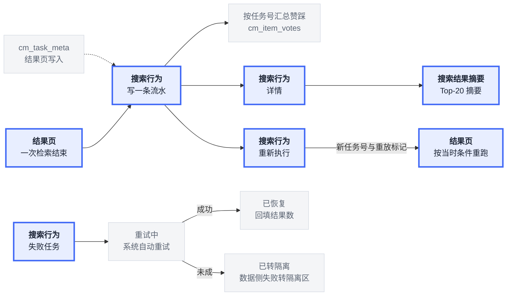

**说明：**

1. 结果页每次检索结束写 cm_task_meta；本页加载时读它并按任务号并入流水，一条检索一条记录。
2. 流水字段：时间、任务号、操作人、模态对、输入内容、结果数、赞踩数；结果数有值即搜到，为「—」即没搜到。
3. 赞踩数按任务号从 cm_item_votes 汇总，写成赞数 / 踩数；两条都为零显示 0 / 0。
4. 行只作展示，动作走操作列两处：详情进搜索结果摘要，重新执行按当时条件重跑。
5. 重新执行生成新记录：新任务号、新时间、新结果数，条上标「⟳ 重放自 原任务号」，再携新任务号跳结果页。
6. 重新执行继承原记录的操作人、模态对、输入内容；同一 query 重放几次就留几条记录，用来对比治理前后。
7. 详情只读 cm_task_summary 的 Top-20 摘要（条目 ID、名称、分数），不存文件本体；摘要保留 30 天。
8. 失败任务单独一张表，处置状态由系统推进：重试中、已恢复、已转隔离；数据侧失败转隔离区，不回到检索流水。

**状态：**

| 当前 | 触发 | 前置 | 下一 |
| --- | --- | --- | --- |
| 无 | 任务执行失败 | 系统自动 | 重试中 |
| 重试中 | 重试成功 | 系统自动 | 已恢复 |
| 重试中 | 重试未成 | 系统自动 | 已转隔离 |

搜索记录只有结果数这一列表达成败，上表只记失败任务的处置。

不允许：已恢复回到重试中；已转隔离回到重试中；失败任务的处置由人工改。

### 3.4 搜索结果摘要（P3，Top-20 + 标记不匹配 + 封存）
**目标：** 一个任务变成一屏可核对的摘要：任务信息（含检索策略的名称与版本）、Top-20 摘要表。任务信息与摘要按任务号读结果页写入的 cm_task_summary；读不到时显示「未找到该任务的摘要」空态。不匹配条目提交后封存，本步结束。

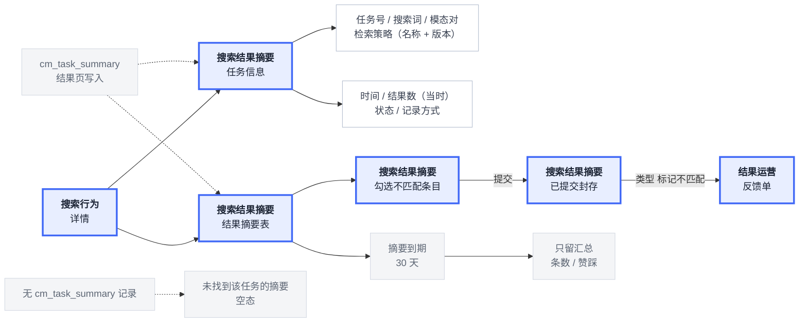

**说明：**

1. 搜索行为点详情进本页；任务信息给任务号、搜索词、模态对、检索策略（策略名 + 版本）、时间、结果数（当时）、状态、记录方式共 8 项。
2. 任务信息与结果摘要都优先读 cm_task_summary（键=任务号）；有记录时按 q / time / n / pair / stg / thr / items 渲染。
3. 无记录且不是演示任务时显示「未找到该任务的摘要」空态，不回落其他任务；任务号仍显示地址栏里的真实任务号。
4. 结果摘要按相似度降序固定展示 Top-20：排名、条目 ID、名称、相似度，另带一列勾选。
5. 摘要存的是条目 ID、名称、分数，落库保留 30 天；到期只留汇总，即条数与赞踩数。
6. 勾选不匹配条目后提交，生成一条「标记不匹配」反馈单，类型由入口定；去向不在本页预填，留到结果运营处理时确定。
7. 提交即封存：本任务的勾选与提交锁死，再进来是已提交态。
8. 失败任务不生成摘要，只展示失败原因与「查看失败任务」；重放任务顶部显示「当时 → 现在」条数，摘要展示本次重放的 Top-20。

**状态：**

| 当前 | 触发 | 前置 | 下一 |
| --- | --- | --- | --- |
| 未提交 | 勾选条目并提交 | 至少勾一条不匹配条目 | 已提交 |

不允许：已提交回到未提交；同一任务再生成一张不匹配反馈单。

### 3.5 策略配置（P5）
**目标：** 一条策略从参数改动变成生效版本。三段参数写进策略表，发布同时写版本历史。发布即生效，回滚是发布之后另起的一条路；下线与上线单独成对，系统默认策略始终兜底。

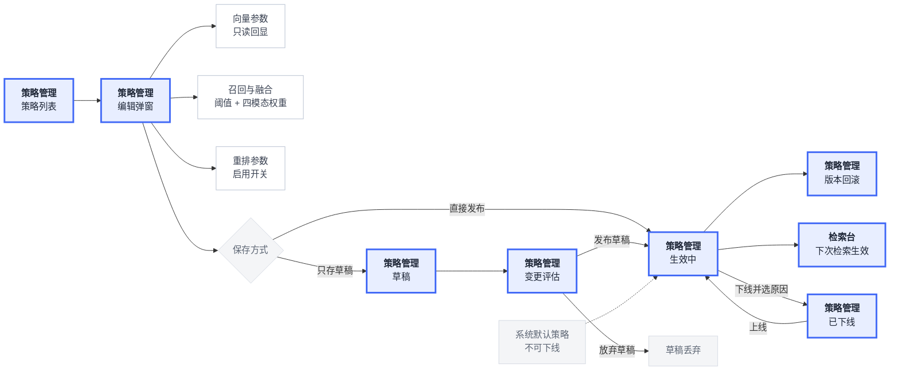

**说明：**

1. 策略列表一行一条策略，列为策略 ID、名称、版本、状态、更新时间、操作；演示 5 条，其中 4 条生效中、1 条草稿。
2. 状态三种：生效中、草稿、已下线；编辑中是保存过程中的过渡态，不落库。
3. 三段参数：向量只读回显，模型由平台固定；召回与融合含相似度阈值（默认 0.60）与四模态权重（合计 100%）；重排是一个启用开关。三段一起存、一起生效。
4. 存草稿只写待发布参数，检索仍用当前生效版本；新建策略保存草稿落「草稿」，不进检索台下拉。
5. 保存并发布把参数写成生效版本，版本号升一版并写版本历史，该策略的下次检索即生效。
6. 版本回滚把配置、版本号一起回写到所选版本；版本历史只保留最近 10 个版本；已下线策略回滚后仍是已下线，需上线才回下拉。
7. 下线：生效中策略填下线原因（策略调整中 / 效果不佳 / 已被替代 / 其他），确认后转已下线；检索台下拉不再出现该策略，已用该策略的历史任务不受影响。
8. 系统默认策略（兜底）不可下线；点下线直接拦截。即使业务策略全部下线，检索台仍回退到系统默认策略并提示。
9. 一致性检查只读 5 项：检索台可选策略不少于 1 条、默认兜底策略存在且生效、每条阈值在 0.30~0.99、每条四模态权重合计 100%、已下线策略数（只展示数量，属正常状态，不计失败）。

**状态：**

| 当前 | 触发 | 前置 | 下一 |
| --- | --- | --- | --- |
| 无 | 新建策略并保存草稿 | 名称非空 | 草稿 |
| 草稿 | 保存并发布 | 有草稿待发布 | 生效中 |
| 生效中 | 改参数后存草稿 | 名称非空 | 生效中（待发布） |
| 生效中 | 发布草稿 | 有草稿待发布 | 生效中（版本 +1） |
| 生效中 | 下线 | 非系统默认策略，且已选下线原因 | 已下线 |
| 已下线 | 上线 | 无 | 生效中 |
| 生效中 | 回滚到历史版本 | 有历史版本 | 生效中 |
| 已下线 | 回滚到历史版本 | 有历史版本 | 已下线 |

不允许：系统默认策略下线；草稿未经发布变为生效中；已下线策略直接回到检索台下拉；同一策略同时存在两条生效版本。

### 3.6 效果评测（P8，基准对照，无状态）
**目标：** 一条历史搜索记录被定为基准，之后同一条 query 每次重新执行都记进这条评测，拿结果数与踩数跟基准比，回答这条搜索现在比当时好还是差。评测列表用表格看结论，难例样本集从点踩自动汇总，检查评测数据只读核对样本质量。基准与重放都取自真实搜索与真实赞踩，不另建标准答案。

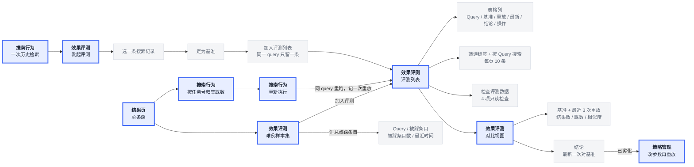

**说明：**

1. 基准取搜索行为的一条历史记录：时间、query、结果数、该次踩数；发起评测时按 query 或时间捞记录，选定一条定为基准。
2. 定为基准的记录进评测列表并排在最前；同一 query 只留一条评测，重复选同一条 query 不新建。
3. 重放不单独发起：在搜索行为对同一条 query 重新执行，重跑出的新记录按 query 归到这条评测，重放次数加一；也可从难例样本集直接加入评测。
4. 评测列表是表格，列固定为 Query、基准（时间 · 条数 · 踩数）、重放、最新（条数 · 踩数）、结论、操作；上方按 Query 搜索，结论筛选标签为全部 / 已劣化 / 正常 / 未评测，每页 10 条。
5. 结论三种：已劣化、正常、未评测。判定看最新一次重放对基准，踩数上升 / 踩率 +5% / 结果数 −10% 任一成立即已劣化；有重放但三项都未触发为正常；一次都没重放为未评测。
6. 已劣化的行整行浅红；对比视图给阻断提示，只提示、不强制拦截；列表可按「已劣化」筛选。
7. 对比视图是指标对比表：行=指标，列=基准 + 最近 3 次重放 + 变化；最新一次对基准算变化，完整重放次数以行内「重放 N 次」为准。
8. 难例样本集从结果页单条点踩自动汇总：一行一个 query，列为 Query、被踩条目、被踩条目数、最近时间、操作；被踩条目数按条目去重，不统计点踩次数。
9. 检查评测数据只读 4 项：样本够不够（评测数与基准样本总数）、有没有重复用（同一条目出现在几个评测的基准里）、样本还有效吗（条目被屏蔽或来源进黑名单）、评价矛盾吗（同一条目在不同任务里既被赞又被踩）。
10. 评测本身不设流转状态，结论是重放对基准算出来的视图；加入即可看，重放次数只增不减。

**状态：**

| 当前 | 触发 | 前置 | 下一 |
| --- | --- | --- | --- |
| 未评测 | 首次重放完成且未触发劣化 | 至少 1 条重放记录，三项条件均未成立 | 正常 |
| 未评测 | 首次重放完成且触发任一项 | 至少 1 条重放记录，三项条件任一成立 | 已劣化 |
| 正常 | 最新重放触发任一项 | 踩数上升 / 踩率 +5% / 结果数 −10% | 已劣化 |
| 已劣化 | 调整策略后重放未再触发 | 三项劣化条件均未成立 | 正常 |
| 正常 | 再次重放未触发 | 三项劣化条件均未成立 | 正常 |

不允许：无重放却给出正常或已劣化；同一 query 建两条评测；把已劣化直接改成正常而不经过重放。

### 3.7 结果运营（P7，反馈处理）
**目标：** 两个入口的评价变成可处理的反馈单。类型随入口定，去向由处理判断定，只有三种去向：屏蔽数据、调整策略、补充数据。处理完转已处理，本步结束；屏蔽与调参的落地动作分别落到检索排除与策略管理。

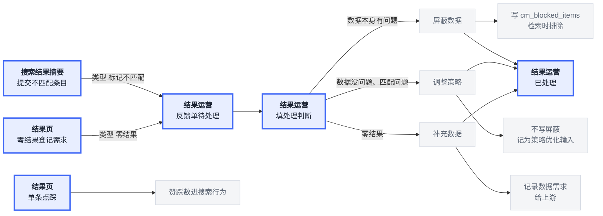

**说明：**

1. 反馈单只有两个入口：搜索结果摘要提交不匹配条目，进的是「标记不匹配」；结果页零结果处置里登记需求，进的是「零结果」。
2. 类型随入口带入，只读；去向不在入口定，处理时由处理判断决定。
3. 处理判断按入口给：标记不匹配是二选一——数据本身有问题 → 屏蔽数据，数据没问题、是匹配或排序问题 → 调整策略；零结果固定为库里缺这类数据 → 补充数据。
4. 屏蔽数据把条目 ID 写入 cm_blocked_items，结果页渲染前读取并排除，立即生效；上游数据本身不变。
5. 调整策略不写屏蔽列表，只记处理判断与去向，作为策略管理与效果评测的优化输入。
6. 补充数据只记录需求给上游，平台不自己补数据。
7. 未处理反馈的「去向」列显示「—」，不预填；处理完才写入去向与是否屏蔽。
8. 状态只有待处理 / 已处理；处理完刷新后保持，不允许重复处理或手改类型、去向。

**状态：**

| 当前 | 触发 | 前置 | 下一 |
| --- | --- | --- | --- |
| 无 | 提交不匹配条目 | 摘要已勾选至少 1 条 | 待处理（类型 标记不匹配） |
| 无 | 零结果登记需求 | 从零结果入口进入 | 待处理（类型 零结果） |
| 待处理 | 选数据本身有问题并标记已处理 | 已选处理判断 | 已处理（去向 屏蔽数据） |
| 待处理 | 选匹配问题并标记已处理 | 已选处理判断 | 已处理（去向 调整策略） |
| 待处理 | 零结果标记已处理 | 判断固定为库里缺这类数据 | 已处理（去向 补充数据） |

不允许：已处理回到待处理；同一反馈单重复处理；处理时改类型或手改去向；未处理就预填去向。

### 3.8 数据出域边界（导出不做）
**目标：** 数据不出域，平台不提供下载与导出。结果的使用以查看、收藏与条目 ID 引用替代。

**说明：**

1. 结果页只提供查看、收藏与条目 ID 引用；收藏只记条目 ID 与元数据，不复制文件本身。
2. 搜索结果摘要只存条目 ID、名称、分数，不存图片、音频、视频本体。
3. 需要对外协作时，以条目 ID 引用代替文件外发；条目 ID 在结果页、搜索结果摘要、反馈单三处一致。
4. 上游补数需求只传 query 与缺口描述，不回传原始数据。
5. 下载与导出能力不做；若后续要开，需另立数据出域评审，不在本期范围。

**状态：** 本条是范围边界，不产生状态流转与记录。

## 4. 模块之间的数据
**目标：** 看模块之间交什么。第一张按交付方向只向右画交给下一站，第二张同样只向右画写回。图里只写交接物，处理规则见第 3 节。

**交给下一站：**

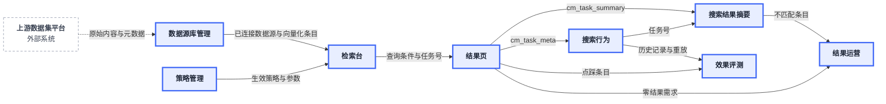

**写回：**

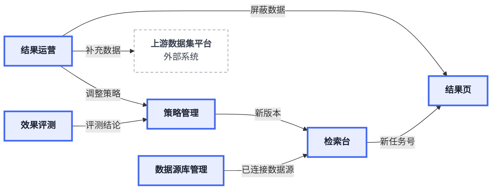

**说明：**

1. 第一张从左到右：外部数据集平台只交原始内容与元数据；数据源库管理把已连接数据源与向量化后的条目交给检索台。
2. 检索台把查询条件与任务号交给结果页；结果页写 cm_task_meta 与 cm_task_summary，分别供搜索行为与搜索结果摘要使用。
3. 搜索行为把任务号交给搜索结果摘要；摘要的不匹配条目与结果页的零结果需求都进结果运营。
4. 策略管理把生效策略与参数交给检索台；搜索行为把历史记录与重放交给效果评测，结果页点踩条目也进评测的难例样本集。
5. 第二张看写回：结果运营按三种去向分别写屏蔽列表、回策略管理、给上游提数据需求；评测结论回策略管理出新版本，新版本与已连接数据源再交给检索台。

## 5. 模块功能架构
**目标：** 分清一级、二级和功能点。深蓝是一级菜单分组，粗蓝框是二级页面，灰细框是页面上的功能点。

```mermaid
flowchart TB
  SYS["跨模态检索中心"] --> DATA["<b>数据</b>"]
  SYS --> SEARCH["<b>检索</b>"]
  SYS --> GOV["<b>策略与运营</b>"]

  DATA --> KM["<b>数据源库管理</b>"]
  KM --> K1["数据源列表"]
  KM --> K2["对接数据源"]
  KM --> K3["测试连接"]
  KM --> K4["字段完备"]
  KM --> K5["向量化"]
  KM --> K6["接口对接定义"]
  KM --> K7["黑名单"]

  SEARCH --> ST["<b>检索台</b>"]
  SEARCH --> RP["<b>结果页</b>"]
  SEARCH --> SD["<b>搜索结果摘要</b>"]
  SEARCH --> SB["<b>搜索行为</b>"]

  ST --> S1["查询输入"]
  ST --> S2["模态矩阵"]
  ST --> S3["检索策略"]
  ST --> S4["意图澄清"]

  RP --> R1["结果卡与相似度"]
  RP --> R2["筛选与分组"]
  RP --> R3["单条赞踩"]
  RP --> R4["零结果处置"]
  RP --> R5["收藏"]

  SD --> D1["任务信息"]
  SD --> D2["Top-20 摘要表"]
  SD --> D3["标记不匹配"]

  SB --> G1["流水列表"]
  SB --> G2["赞踩汇总"]
  SB --> G3["详情"]
  SB --> G4["重新执行"]
  SB --> G5["失败任务"]

  GOV --> SM["<b>策略管理</b>"]
  GOV --> EV["<b>效果评测</b>"]
  GOV --> OP["<b>结果运营</b>"]

  SM --> M1["策略列表"]
  SM --> M2["编辑弹窗"]
  SM --> M3["变更评估"]
  SM --> M4["版本回滚"]
  SM --> M5["上线与下线"]
  SM --> M6["一致性检查"]

  EV --> V1["发起评测"]
  EV --> V2["评测列表"]
  EV --> V3["对比视图"]
  EV --> V4["难例样本集"]
  EV --> V5["检查评测数据"]
  EV --> V6["劣化判定"]

  OP --> O1["反馈列表"]
  OP --> O2["反馈处理"]
  OP --> O3["三种去向"]

  classDef l1 fill:#4169f6,stroke:#4169f6,color:#ffffff,stroke-width:2px
  classDef l2 fill:#e8eeff,stroke:#4169f6,color:#1c2434,stroke-width:3px
  classDef fn fill:#ffffff,stroke:#b7c0d0,color:#3a4252,stroke-width:1px
  classDef root fill:#ffffff,stroke:#1c2434,color:#1c2434,stroke-width:1px
  class DATA,SEARCH,GOV l1
  class KM,ST,RP,SD,SB,SM,EV,OP l2
  class K1,K2,K3,K4,K5,K6,K7,S1,S2,S3,S4,R1,R2,R3,R4,R5,D1,D2,D3,G1,G2,G3,G4,G5,M1,M2,M3,M4,M5,M6,V1,V2,V3,V4,V5,V6,O1,O2,O3 fn
  class SYS root
```

**说明：**

1. 一级三个：数据、检索、策略与运营，是菜单分组，没有独立页面。
2. 二级八个：数据源库管理、检索台、结果页、搜索结果摘要、搜索行为、策略管理、效果评测、结果运营。
3. 灰框是页面上的功能点，一个页面一组；数据源库管理只有数据源与黑名单两块，策略管理只有策略列表与两个弹窗。

